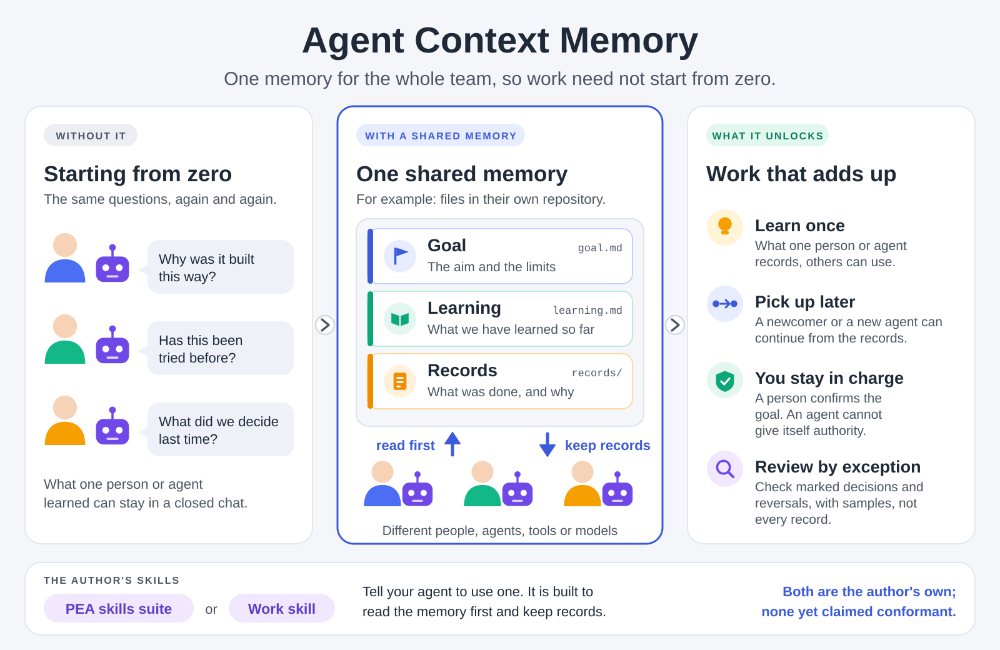

# Agent Context Memory (ACM)

**A specification for how AI-assisted work is kept organised in one shared memory, so that humans can audit it and stay responsible for the result.** Version 0.9.0 (a working draft).

📄 **[Read the full specification →](./SPEC.md)**

An agent starting a task begins from what earlier work learned, found and was corrected on, read from a memory kept apart from the code and organised by scope. One person is a team of one; only the number of people and agents writing changes.

Agent Context Memory is abbreviated **ACM**. An ACM repository used by a team is called **Shared ACM**. Versions through 0.8.0 were published as Shared Agent Context Memory (SACM); that history and those citations remain valid.

## The mandate gate

Governed work needs a principal-confirmed mandate already in memory, read by the agent before it acts, with the agent's interpretation visible in the trace. The agent may help draft it but cannot confirm its own authority.

## Three tiers, by trust

| Tier | Role | Author |
|------|------|--------|
| **Intent** | The principal's mandate: what, why and constraints | Confirmed by the principal; the agent may draft |
| **Trace** | The agent's own account; source records are append-only | The agent |
| **Evidence** | Observations the agent cannot author, filter, alter or delete | A component separate from the agent |

21 numbered requirements (R-01 to R-21), each with a check in Appendix A, and two conformance levels: minimal (intent and trace; evidence may be absent, and says so) and full (adds independent capture and evaluation). Every requirement is Proposed: nothing is claimed as implemented or conformant. The specification requires properties, not a layout; the reference layout is one folder per scope holding `goal.md`, `learning.md` and `records/`, in a memory repository of its own.

The [Agent Cognition Skills (ACS)](https://github.com/ntholm86/agent-cognition-skills) and the [Work skill](https://github.com/ntholm86/work-skill) are the author's own implementations of it, none yet claimed conformant. The specification names no implementation; another framework can implement it. It implements the [Principles of Earned Autonomy (PEA)](https://github.com/ntholm86/principles-of-earned-autonomy), its one dependency.

## Adopting it

To start, create a memory repository of your own that follows the specification, bind your work repository to it, and use an implementation such as the Work skill; as the author does with his own, it can be applied privately anywhere. The first questions adopters ask:

- **How big does it get?** A task reads the mandates and the scope's current learning and reaches the rest by reference, so what it costs to read does not grow with the number of records, writers or years (R-20). Record what the code cannot tell (decisions, reasons, corrections, constraints) and keep the rest out: everything admitted costs every later reader. How the files are stored is the implementation's choice.
- **What does it cost?** Net cost is tokens, developer days, speed and quality. The saving is mostly time, which the memory does not measure; it is yours to be aware of, not to prove.
- **Can a person audit it?** By exception: marked reversals and decisions, derived views and sampled source, not every record (R-20).

## Citation

Cite ACM using [CITATION.cff](./CITATION.cff). The v0.9.0 version DOI is [10.5281/zenodo.24624570](https://doi.org/10.5281/zenodo.24624570); the concept DOI [10.5281/zenodo.20785505](https://doi.org/10.5281/zenodo.20785505) covers all versions. Version 0.8.0 is preserved at [10.5281/zenodo.24469043](https://doi.org/10.5281/zenodo.24469043), 0.7.0 at [10.5281/zenodo.24455165](https://doi.org/10.5281/zenodo.24455165), and 0.5.0 at [10.5281/zenodo.24431974](https://doi.org/10.5281/zenodo.24431974). Published versions retain the title under which they were released.

[CC BY-SA 4.0](./LICENSE) — [Nils Wendelboe Holmager](https://nilsholmager.com/), 2026
